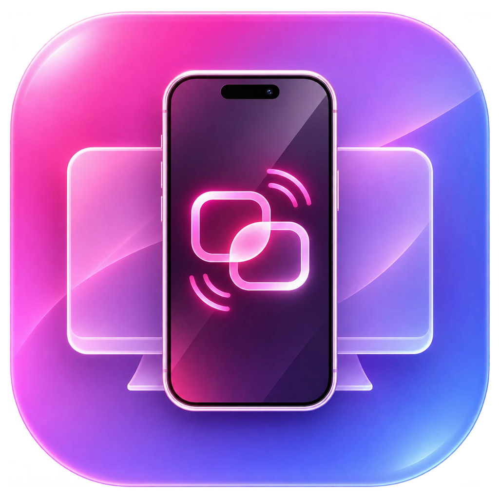

<p align="center">
  
</p>

<h1 align="center">🔗 ZenLink — iPhone &amp; iPad Mirroring and Control for Windows</h1>

<p align="center">
  <b>Mirror, control and live-stream your iPhone or iPad on a Windows PC — over the cable or Wi-Fi.</b><br>
  <i>Two connection modes, each over cable or Wi-Fi: Apple Driver (full control) and ZenLink Studio for live streaming (USB capture or AirPlay, the way TikTok LIVE Studio does it).</i>
</p>

<p align="center">
  <a href="https://zenvyzenshiro.github.io/zenlink/"></a>
  <a href="https://github.com/zenvyzenshiro"></a>
  <a href="https://sociabuzz.com/zenvy/tribe" target="_blank"></a>
  <a href="LICENSE"></a>
  
  
  <a href="../../releases/latest"></a>
  <a href="../../releases"></a>
</p>

> ### 🛡️ Tested & Verified Environment
> - 📱 **Device**: **iPad (11th generation)**, physical device running **iOS 27.0.1**
> - 💻 **PC**: **Windows 11 Pro**, build 26200, 64-bit
> - 🚀 **Measured**: ZenLink Studio cable 52–56 fps at 12–30 Mbps; ZenLink Studio AirPlay 3108×2160 at ~46 fps with ~16 ms picture delay; native sound output ~23 ms (WASAPI)

---

### 🌟 Author, Attribution & Open-Source Lineage
> - **Creator & Lead Developer**: **Zenvy Zenshiro** ([GitHub `@zenvyzenshiro`](https://github.com/zenvyzenshiro) · [Sociabuzz](https://sociabuzz.com/zenvy/tribe)).
>   Designed and built ZenLink: the two-mode connection system with driver manager and safe rollback, ZenLink Studio (QuickTime capture over libusb0, and an AirPlay screen-mirroring receiver), Wi-Fi for Apple Driver mode without Bonjour, low-latency `<video>` playback with H.264 SPS rewriting, native WASAPI sound with lip sync and a Wi-Fi jitter buffer, OCR copy, stealth dim, wake & unlock, system tray, and the black + pink bilingual (ID/EN) interface.
> - **Original open-source sources ZenLink builds on** (all used under their own licenses):
>   - [**pane-iphone-mirror-windows**](https://github.com/teyboxv1/pane-iphone-mirror-windows) by **teyboxv1** (GPL-3.0) — the original Pane project: iPhone mirroring on Windows through CoreDevice.
>   - [**pymobiledevice3**](https://github.com/doronz88/pymobiledevice3) by **Doron Zavelevsky** (GPL-3.0) — RemoteXPC / RSD tunnel, CoreDevice screen stream, lockdown and pairing.
>   - [**quicktime_video_hack**](https://github.com/danielpaulus/quicktime_video_hack) by **Daniel Paulus** (MIT) — reference for the QuickTime screen-capture USB protocol used by ZenLink Studio (cable).
>   - [**libusb-win32**](https://sourceforge.net/projects/libusb-win32/) by **Stephan Meyer & Travis Lee Robinson** (driver GPL, library LGPL) — the libusb0 driver bundled in `drivers/libusb-win32` (unmodified, signed binaries; source at the link).
>   - [**libwdi / Zadig**](https://github.com/pbatard/libwdi) by **Pete Batard** (LGPL / GPL) — the driver-package approach ZenLink follows; Zadig itself is not bundled.
>   - [**UxPlay**](https://github.com/FDH2/UxPlay) by **F. Duncanh** and [**RPiPlay / shairplay**](https://github.com/FD-/RPiPlay) (GPL-3.0) — the AirPlay mirroring protocol reference. ZenLink's AirPlay receiver is written in Python; the **playfair** FairPlay code in `native/playfair` is used unmodified (GPL-3.0).

---

## 🚀 Key Features

| Feature | Description |
| :--- | :--- |
| **🔌 Two connection modes** | Choose before anything connects: **Apple Driver** (Apple's own driver, full control) or **ZenLink Studio** (for live streaming, like TikTok LIVE Studio). Each offers **Kabel** or **Nirkabel (Wi-Fi)**. "Remember my choice" skips the question next time. |
| **📡 ZenLink Studio over Wi-Fi (AirPlay)** | ZenLink is an AirPlay receiver: on the iPhone/iPad open **Control Center → Screen Mirroring → ZenLinkStudio**. No driver, no cable. The device's own stream is passed through untouched (HEVC or H.264, up to its native resolution); the how-to is shown on screen. |
| **🎥 ZenLink Studio over the cable** | QuickTime capture over USB in H.264 at the device's full native resolution and high bitrate (measured 2360×1640 on iPad 11th gen, 12–30 Mbps, up to ~56 fps). Picture and sound only. |
| **📶 Apple Driver over Wi-Fi** | Plug the device in once in Apple mode and ZenLink sets up Wi-Fi by itself; afterwards choose **Nirkabel**. ZenLink finds the device on the network itself, even where Windows gets no Bonjour replies. |
| **📊 Live stats** | FPS, video delay and audio delay next to the device name (switchable in Settings). |
| **⚡ Real-time playback** | WebCodecs hardware decoding straight into a `<video>` surface; H.264 SPS rewrite cuts decoder delay from ~200 ms to ~0–1 ms. |
| **🔊 Synced sound** | Native WASAPI output (~22 ms) with an adaptive buffer and lip sync, so picture and sound arrive together. |
| **🖱️ Touch, keyboard & gestures** | Mouse as touch, PC keyboard typing, trackpad scrolling, Home / App Switcher / Notifications / Control Center, hardware buttons — follows rotation. |
| **📋 OCR copy & paste** | `Alt+C` copies the text on the device screen to the PC (Windows OCR, stitches scrolled pages), `Alt+V` types the PC clipboard on the device. |
| **🌑 Stealth dim, wake & lock** | `Alt+D` dims the device to 0% while the picture stays bright; `Alt+U` wakes and types your passcode (DPAPI-encrypted); `Alt+L` locks. |
| **🛠️ Safe driver manager** | Install / restore drivers only after you confirm, with UAC, a backup and automatic rollback. Never stacks a libusb0 filter on Apple's driver. |
| **📥 System tray & low memory** | Close to tray, show/hide and start/stop from the tray icon, working set trimmed while hidden. |
| **🇮🇩 / 🇬🇧 Bilingual UI** | Bahasa Indonesia by default, English with one click (top right). Black + pink theme, light theme too. |

---

## ⌨️ Keyboard Shortcuts

| Shortcut | Action |
| :---: | :--- |
| **`Space`** | Start / stop casting |
| **`Alt + H`** | Rotate: Auto / 90° / 270° |
| **`Alt + C`** | Copy the text on the device screen to the PC (OCR) |
| **`Alt + R`** | Clear the copied-text history |
| **`Alt + V`** | Type the PC clipboard text on the device |
| **`Alt + D`** | Stealth dim: device screen to 0% / restore |
| **`Alt + U`** | Wake & unlock (types the saved passcode) |
| **`Alt + L`** | Lock the device |
| **`Ctrl + K`** | Show / hide the on-screen keyboard |
| **`Ctrl + C / X / V`** | Copy / cut / paste inside iOS |
| **`Ctrl + A / Z`** | Select all / undo inside iOS |
| **`Alt + Left`** | Back (swipe from the left edge) |
| **`G`** · **`M`** · **`F11`** · **`Esc`** | Gestures panel · mute · full screen · leave full screen |

Device shortcuts work in Apple Driver mode while casting.

---

## 📦 Quick Start

### 📋 Requirements (Persyaratan)

- **Windows 10 (1809+) or Windows 11, 64-bit**, with Microsoft Edge **WebView2** (built into Windows 11).
- **Apple Devices** (Microsoft Store) or iTunes, for Apple's USB driver and Apple Mobile Device Service.
- **iOS 17 or newer** for Apple Driver mode, with **Developer Mode** on: connect the cable, tap **Trust This Computer**, then **Settings → Privacy & Security → Developer Mode → On** and restart. *(If the toggle is missing, opening a screen-mirroring tool once — e.g. 3uTools → Realtime Screen — makes it appear.)*
- ZenLink Studio (cable or AirPlay) works without Developer Mode. AirPlay needs the PC and the device on the same network; the installer (or the first run of `Start ZenLink.bat`) offers to allow ZenLink through Windows Firewall.

### Option 1A: Installer (Recommended)
1. Download **`ZenLink-vX.Y.Z-Setup.exe`** from [**Releases**](../../releases/latest).
2. Run it and follow the steps (Bahasa Indonesia or English). ZenLink appears in the Start Menu and, if you want, on the Desktop.
3. Open **ZenLink**, choose a connection mode, plug in your device and press **Mulai mirroring / Start casting**.

### Option 1B: Portable (one .exe, no installation, no Python)
1. Download **`ZenLink-vX.Y.Z-Portable.exe`** from [**Releases**](../../releases/latest) and put it anywhere.
2. Double-click it. The first start takes a few seconds (it unpacks itself); settings are kept in `%LOCALAPPDATA%\ZenLink`.

### Option 2: Run from Source
```powershell
git clone https://github.com/zenvyzenshiro/zenlink.git
cd zenlink
.\"Start ZenLink.bat"
```
The first run sets everything up: it installs Python 3.13 with winget if needed, creates the environment and installs `requirements.txt`, checks WebView2, offers Apple Devices (for Apple Driver mode) and the firewall permission for AirPlay. Later runs open straight away. **`run.bat`** starts ZenLink with a visible console log.

Tests: `.venv\Scripts\python -m unittest discover -s tests` (no device needed; `tests\airplay_sim.py` simulates an iPhone mirroring over AirPlay).

To build the release files yourself: `powershell -ExecutionPolicy Bypass -File .\build_portable_release.ps1` (PyInstaller; Inno Setup 6 for the installer).

---

## 🔌 Connection Modes

| | **Apple Driver** (Standard) | **ZenLink Studio · Kabel** | **ZenLink Studio · Wi-Fi (AirPlay)** |
| :--- | :--- | :--- | :--- |
| Driver | Apple's own, nothing to install | libusb0 as the device's driver (installed by ZenLink after you confirm) | None |
| Video | HEVC, about 4–6 Mbps (device limit) | H.264 at native resolution, 12–30 Mbps, up to ~56 fps | The device's own HEVC / H.264, up to native resolution |
| Control | Touch, keyboard, gestures, buttons | Picture and sound only | Picture and sound only |
| Wi-Fi | Yes (set up automatically once over the cable) | — | Yes (Control Center → Screen Mirroring) |
| Apple apps (iTunes, Apple Devices) | Keep working | Can't see the device until you restore Apple's driver | Keep working |

Switch any time in **Settings → Connection & Drivers**. Changing the driver asks for administrator permission, saves a backup and rolls back on failure; unplug and reconnect the cable afterwards.

---

## 🛠️ Under the Hood

```
┌──────────────────┐  Apple Driver: RemoteXPC / RSD tunnel (USB or Wi-Fi)   ┌─────────────────────────┐
│  iPhone / iPad   │ ◄────────────────────────────────────────────────────► │  ZenLink                │
│  (iOS 17+)       │  Studio: QuickTime over libusb0, or AirPlay (Wi-Fi)    │  • UI on 127.0.0.1 only │
└──────────────────┘  • HEVC / H.264 video  • PCM sound  • HID touch & keys │  • WebView2 + WebCodecs │
                                                                            └─────────────────────────┘
```

1. **One process**: the local server (aiohttp) runs inside the app; the window is WebView2 (pywebview).
2. **Apple Driver**: `pymobiledevice3` opens a CoreDevice tunnel (USB, or Wi-Fi via Apple Mobile Device Service / RemotePairing) and the DisplayService stream.
3. **ZenLink Studio · Kabel**: ZenLink switches the device into its QuickTime configuration through libusb0 and reads the H.264 + audio stream directly.
4. **ZenLink Studio · AirPlay**: ZenLink advertises itself over mDNS, completes pairing and FairPlay, decrypts the mirror stream (AES-CTR video, AES-CBC AAC-ELD audio) and passes the device's video straight to the decoder.
5. **Local only**: video, sound, OCR and keystrokes never leave your PC. No telemetry.

---

## 🔒 Privacy & Clean Uninstall

- The passcode for `Alt+U` is encrypted with Windows DPAPI for your account only; remove it any time in Settings.
- **Installer version**: uninstall from **Windows Settings → Apps**.
- **Portable exe**: delete the `.exe` and the `%LOCALAPPDATA%\ZenLink` folder.
- **Source**: run **`Uninstall-ZenLink.bat`** — it closes ZenLink, deletes its settings, passcode, logs and WebView2 cache, removes the shortcuts and can delete the folder.
- If you used ZenLink Studio over the cable, press **Restore Apple driver** in Settings first so Apple apps see the device again.

---

## 💖 Support This Project (Dukung ZenLink)

Kalau **ZenLink** membantu streaming, kerja, atau main game kamu di Windows, kamu bisa mendukung pengembangannya lewat **Sociabuzz**:

<p align="left">
  <a href="https://sociabuzz.com/zenvy/tribe" target="_blank">
    
  </a>
</p>

* 🔗 **Sociabuzz:** [**https://sociabuzz.com/zenvy/tribe**](https://sociabuzz.com/zenvy/tribe)

---

## 📄 License & Credits

- **Creator & Lead Developer**: [**Zenvy Zenshiro**](https://github.com/zenvyzenshiro).
- **License**: ZenLink — Copyright © 2026 Zenvy Zenshiro — is free software under the GNU General Public License v3.0 or later ([GPL-3.0](LICENSE)). It comes with ABSOLUTELY NO WARRANTY.
- **Built on**: [pane-iphone-mirror-windows](https://github.com/teyboxv1/pane-iphone-mirror-windows) (teyboxv1, GPL-3.0) · [pymobiledevice3](https://github.com/doronz88/pymobiledevice3) (Doron Zavelevsky, GPL-3.0) · [quicktime_video_hack](https://github.com/danielpaulus/quicktime_video_hack) (Daniel Paulus, MIT) · [libusb-win32](https://sourceforge.net/projects/libusb-win32/) (GPL / LGPL) · [libwdi](https://github.com/pbatard/libwdi) (Pete Batard) · [UxPlay](https://github.com/FDH2/UxPlay) / playfair (GPL-3.0).
- **Libraries**: [aiohttp](https://github.com/aio-libs/aiohttp) (Apache-2.0) · [pywebview](https://github.com/r0x0r/pywebview) (BSD-3) · [PyAV](https://github.com/PyAV-Org/PyAV) (BSD-3) · [pyusb](https://github.com/pyusb/pyusb) (BSD-3) · [python-sounddevice](https://github.com/spatialaudio/python-sounddevice) (MIT) · [pystray](https://github.com/moses-palmer/pystray) (LGPL-3.0) · [Pillow](https://github.com/python-pillow/Pillow) (MIT-CMU) · [python-zeroconf](https://github.com/python-zeroconf/python-zeroconf) (LGPL-2.1) · [PyCryptodome](https://github.com/Legrandin/pycryptodome) (BSD / Public Domain) · [cryptography](https://github.com/pyca/cryptography) (Apache-2.0 / BSD).
- iPhone, iPad and iOS are trademarks of Apple Inc. AirPlay is a trademark of Apple Inc. ZenLink is not affiliated with Apple or TikTok.
